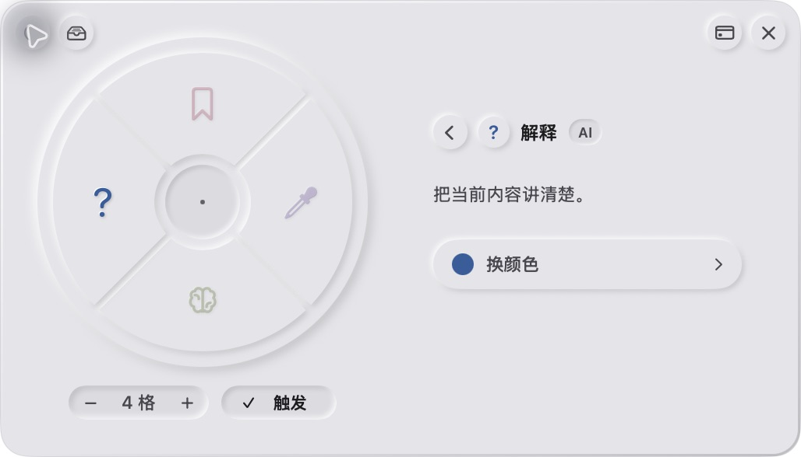
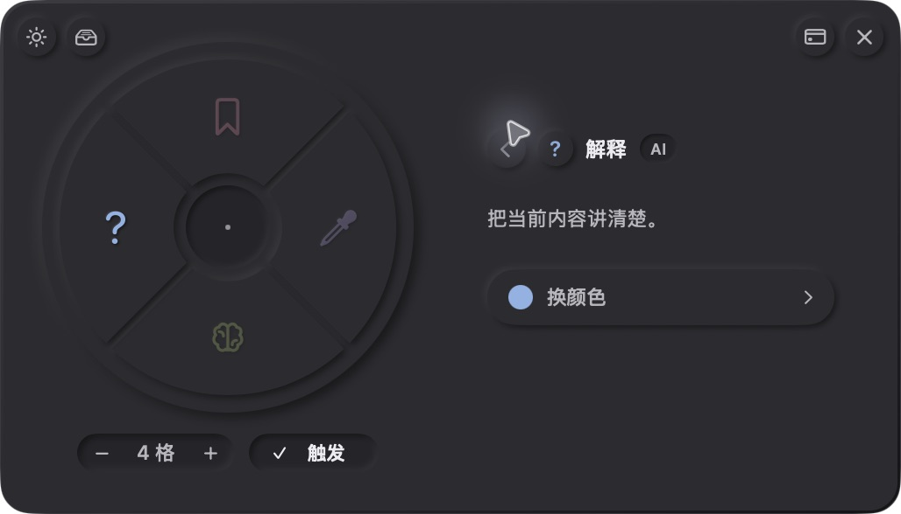

<div align="center">


# PinPin

#### 指一下，让屏幕上的内容更好懂、更好用。

解释、翻译、改写、嘴替，随手取色与收藏。少切一个窗口，少复制一次。


[功能](#你可以用它做什么) · [界面](#看看界面) · [使用](#怎么用) · [构建](docs/build.md) · [反馈](https://github.com/Stormycry-cryp/PinPin/issues)

</div>

PinPin 是一个贴在日常工作旁边的桌面工具。按住快捷键，用鼠标指出一处内容，朝轮盘里的功能方向移动，松手执行。结果留在原处的小卡片里，可以继续追问，也可以收起为标注点。

你可以在阅读文档时解释术语，在网页里翻译一段文字，改写一句表达，或分析聊天语境、准备回复。看到喜欢的颜色和内容，也可以顺手存进资产看板。

## 你可以用它做什么

| 功能 | 可以做的事 |
| --- | --- |
| **解释** | 结合所指内容与周围上下文，解释术语、句子、图表或界面元素。 |
| **翻译** | 翻译当前内容，保留原意。 |
| **改写** | 调整表达，保留原本的事实与条件。 |
| **嘴替** | 分析当前聊天里对方的意图，给出建议回复。 |
| **取色器** | 直接读取屏幕像素，查看色值并保存取色记录，无需大模型。 |
| **收藏与资产** | 保存文字、图片和颜色，在统一看板里查找与复用。 |

解释、翻译、改写和嘴替需要配置 AI 服务。普通客户端收藏会先保存原内容，再尝试生成 AI 说明；未连接时原始收藏仍可保留。取色和已有资产浏览在本地完成。

## 看看界面

界面采用哑光灰面、低饱和功能色和新拟物控件，支持浅色与深色。下面是 macOS 实际窗口：

| 浅色 | 深色 |
| --- | --- |
|  |  |

设置里可以把功能块拖进轮盘，增减到 1–8 格；点击功能进入详情，展开换色面板后连续拖动选色。窗口可以移动，也可以被其他窗口覆盖。

## 怎么用

| 操作 | macOS | Windows |
| --- | --- | --- |
| 打开轮盘 | 按住 Option + 左键 | 按住 Alt + 左键 |
| 执行功能 | 朝功能方向移动，先松左键 | 朝功能方向移动，先松左键 |
| 取消 | 回到中心、空槽，或松开 Option | 回到中心、空槽，或松开 Alt |
| 打开设置 | Option + 右键 | Alt + 右键 |
| 清除标注 | Option + 双击左键 | Alt + 中心双击左键 |

鼠标移出可见轮盘后，同一角度仍可选择功能。设置里的触发开关只控制轮盘手势，不影响设置快捷键。菜单栏空间不足时，再次打开应用也能进入设置。

结果可以分别关闭、收起和追问；悬停标注点查看短卡，点开继续阅读完整内容。

## 从源码开始

```sh
git clone https://github.com/Stormycry-cryp/PinPin.git
cd PinPin
```

macOS 安装 Xcode 后执行 `./scripts/build-macos.sh`；Windows 安装 .NET 10 SDK 后执行 `.\scripts\build-windows.ps1`。AI 服务需要使用自己的 HTTPS 网关和访问令牌，公开仓库不附带作者的私测连接或模型额度。

完整步骤见[构建与配置](docs/build.md)，服务端配置见[网关说明](backend/server/README.md)。

## 项目结构

| 目录 | 内容 |
| --- | --- |
| `backend/Sources/PointOut` | macOS 采集、手势、业务、资产和订阅接口 |
| `backend/platforms/windows` | Windows Core、Native 与应用宿主 |
| `frontend` | macOS 原生组件、Windows WPF 界面与品牌图形 |
| `backend/server` | 模型网关、用量结算和 Apple 交易验证 |
| `scripts` | 合并仓库的构建入口 |
| `docs` | 使用、构建和设计规范 |

macOS 使用 AppKit + SwiftUI，Windows 使用 .NET / WPF，服务端使用 Python / aiohttp。本地取色和轮盘交互由原生代码完成；不使用 OCR。确认 AI 功能后，才发送对应的文字或图片。

## 当前进展

这是用于分享的源码快照，日常开发继续在私有仓库进行，公开仓库按阶段更新。macOS 与 Windows 客户端均在持续迭代；本轮公开整理验证 macOS 构建与本地检查，Windows 未在本轮重新构建。

Mac App Store 的沙盒、StoreKit 2 和订阅服务代码已纳入，真实上架与购买链路仍在准备。AI 对含糊聊天、表格和复杂段落仍可能判断失误，准确完整优先于响应时间；目前不宣称所有场景已通过验收。

## 数据与隐私

- 设置、收藏和取色记录保存在本机。取色直接读取屏幕像素，不发送给模型。
- AI 功能会把所需文字或图片发送到你配置的网关，再由服务端请求对应供应商。
- 客户端只持有应用访问令牌；供应商密钥留在服务端。不要把令牌、Data 目录或个人资料放进公开仓库。

## 反馈与致谢

欢迎通过 [Issue](https://github.com/Stormycry-cryp/PinPin/issues) 分享使用需求和问题。请附系统版本、复现步骤，以及不含个人信息的截图或日志。

取色逻辑参考 [Pika](https://github.com/superhighfives/pika) 与 [Microsoft PowerToys](https://github.com/microsoft/PowerToys)，嘴替策略参考 [goutoujunshi-jev-chat](https://github.com/shengjidaguai-china/goutoujunshi-jev-chat)。对应来源与许可保存在 [ThirdPartyNotices](backend/ThirdPartyNotices/README.md)。主项目尚未指定统一开源许可证，第三方许可分别适用于对应部分。
